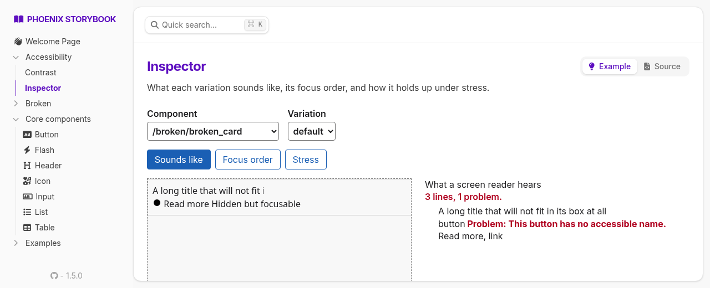
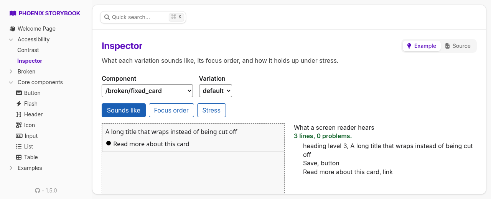
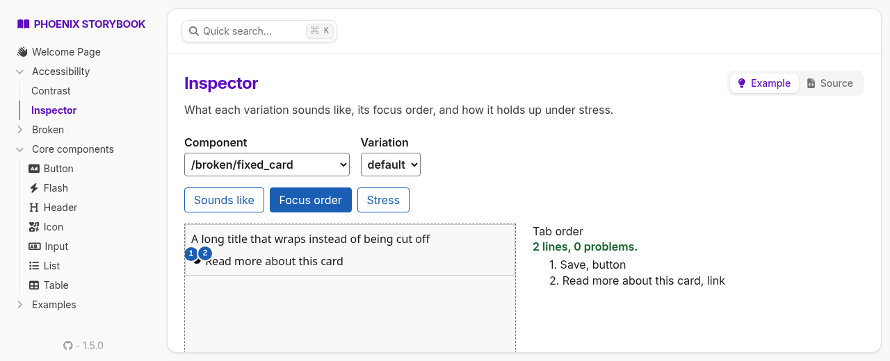
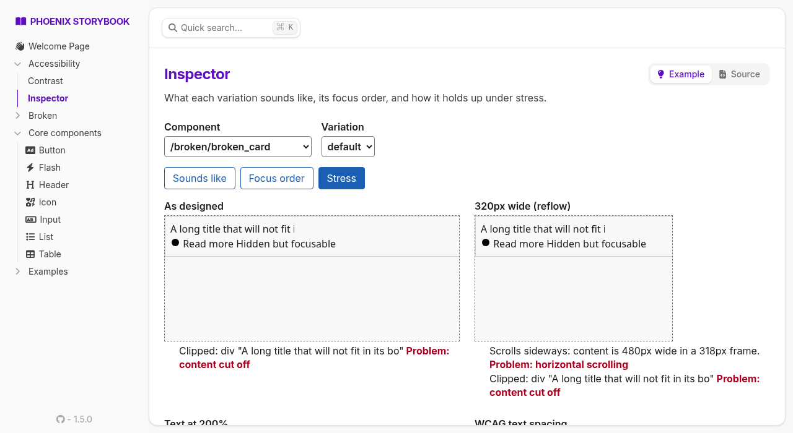
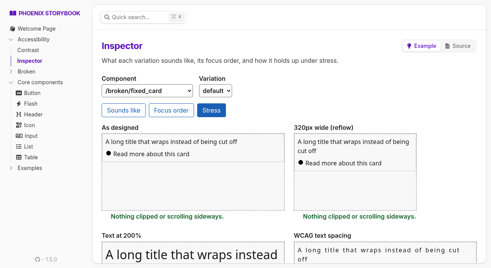

# ExcessibilityStorybook

Accessibility tools that live inside [phoenix_storybook](https://github.com/phenixdigital/phoenix_storybook):

- **Contrast**: every text color on every background in your theme. You get the WCAG 2 ratio and
  the APCA contrast level, and the result says what each pair is good for ("body text",
  "short text: labels, buttons, captions", ...) and how big text in those colors has to be.
- **Sounds like**: roughly what a screen reader announces for a component, element by
  element, with anything unnamed called out.
- **Focus order**: tab stops numbered on the component. It flags controls with no name, duplicate
  names, positive `tabindex`, focusable things hidden from screen readers, and focus that doesn't
  show.
- **Stress**: the component at 320px wide, with 200% text, with WCAG text spacing, through
  color-vision filters and blur. Clipped content and sideways scrolling are reported.

Every result is written out in words; nothing depends on reading a color swatch.

This is for looking at your components while you build them. It is not a CI gate and not a
verdict: automated checks catch a slice of real accessibility problems, and passing them says
little about whether something is usable. For snapshot-based Pa11y/axe checks in your test
suite, see [Excessibility](https://github.com/lessthanseventy/excessibility).

## What it looks like

The same card twice: once with the usual mistakes, once with them fixed.













## Installation

```elixir
def deps do
  [
    {:excessibility_storybook, "~> 0.1", only: :dev}
  ]
end
```

### 1. Register the hook

In your storybook's JS (`assets/js/storybook.js` from `mix phx.gen.storybook`):

```js
import { Hooks as A11yHooks } from "../../deps/excessibility_storybook/priv/static/excessibility_storybook.js"

window.storybook = { Hooks: { ...A11yHooks } }
```

If you already set `window.storybook.Hooks`, spread `A11yHooks` into it.

### 2. Add the stories

```elixir
# storybook/accessibility/contrast.story.exs
defmodule Storybook.Accessibility.Contrast do
  use PhoenixStorybook.Story, :page

  # the stylesheet that defines your --color-* tokens
  @css Path.expand("../../assets/css/app.css", __DIR__)

  def navigation, do: ExcessibilityStorybook.ContrastPage.navigation(@css)
  def render(assigns), do: ExcessibilityStorybook.ContrastPage.render(assigns, @css)
end
```

```elixir
# storybook/accessibility/inspector.story.exs
defmodule Storybook.Accessibility.Inspector do
  use PhoenixStorybook.Story, :example
  use ExcessibilityStorybook.Inspector, backend: MyAppWeb.Storybook
end
```

If your storybook isn't mounted at `/storybook`, pass `storybook_path: "/your/path"` too.

## How it reads your theme

The Contrast page reads `--color-*` custom properties from the stylesheet, one tab per block that
declares them: a daisyUI theme (named by its `name:`), `:root`, `[data-theme=...]`, `@theme`.
Colors can be hex, `rgb()`, `hsl()` or `oklch()`, and `var(--x)` is followed through any custom property in
the file. Anything it can't resolve to a color (`color-mix()`, say) is listed as not measured,
never silently dropped.

Intended pairs follow the daisyUI convention: `X-content` is text on `X`, and `base-content` is
text on every `base-*`.

## What it can't tell you

- **Sounds like is an approximation.** It's computed from the DOM with
  [dom-accessibility-api](https://github.com/eps1lon/dom-accessibility-api); real screen readers
  differ from it and from each other.
- **Components are static.** The Inspector renders each variation with storybook's renderer
  straight into the frame (fast, no LiveView connection per frame), so JS hooks don't run. A state
  that only JS reaches, like an opened modal, needs its own variation.
- **"No visible change on focus" is a heuristic.** It compares computed styles before and after
  focus.
- **The color-vision and blur frames are for looking at.** They report the same clipping as the
  plain frame; they don't judge anything.

## License

MIT. Vendors dom-accessibility-api (MIT), license in `priv/static/vendor/`.
